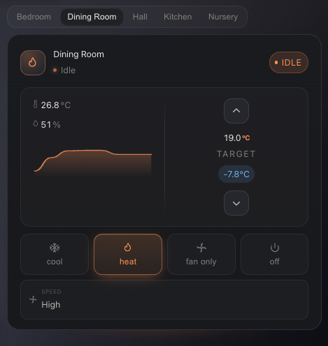
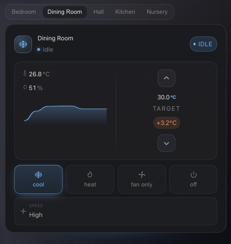
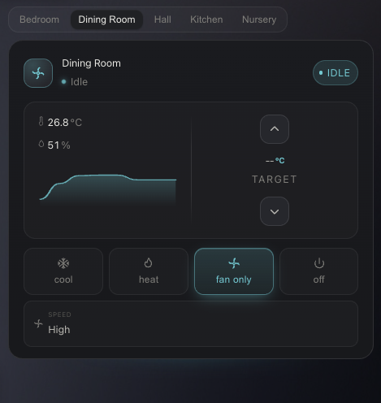
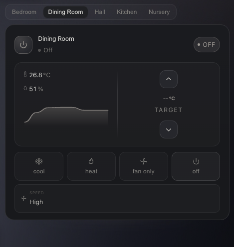

# Nimbus Climate Card

A Home Assistant Lovelace card for climate entities, built as part of the [Nimbus suite](https://github.com/maxfok/nimbus-weather-card).

 
 

## Features

- Multiple climate entities in a single card with tabs
- Sparkline temperature history graph
- Fan, swing and preset mode controls
- Temperature and humidity display with inline icons
- Extra sensor rows (CO2, power, PM2.5 - icon picked automatically from device class)
- Ambient glow that adapts to the active HVAC mode
- Visual editor support

## Installation

### HACS (recommended)

Add this repository as a custom repository in HACS, then install **Nimbus Climate Card**.

### Manual

Copy `nimbus-climate-card.js` to your `/config/www/` folder and add it as a Lovelace resource:

```yaml
url: /local/nimbus-climate-card.js
type: module
```

## Configuration

```yaml
type: custom:nimbus-climate-card
entities:
  - entity: climate.bedroom_thermostat
    name: Bedroom
  - entity: climate.living_room_thermostat
    name: Living Room
    outdoor_sensor: sensor.outdoor_temperature
    sensors:
      - entity: sensor.bedroom_co2
      - entity: sensor.bedroom_power
```

### Options

| Option | Type | Description |
|---|---|---|
| `entities` | list | List of climate entities (required) |
| `entities[].entity` | string | Climate entity ID |
| `entities[].name` | string | Display name |
| `entities[].outdoor_sensor` | string | Outdoor temperature sensor entity ID |
| `entities[].temperature_sensor` | string | Override sensor used for the history graph |
| `entities[].sensors` | list | Extra sensor rows (CO2, power, PM2.5, etc.) |

## Notes

Built against the [HA climate entity spec](https://developers.home-assistant.io/docs/core/entity/climate/) so supported features are detected properly and controls only show up when the entity actually supports them.

Tested on MCO MH5 and MCO MH7-HWH Z-Wave thermostats. Should work with any HA climate entity.
